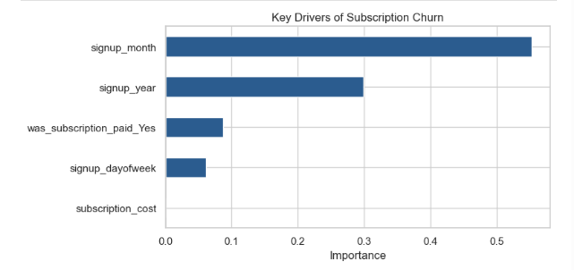
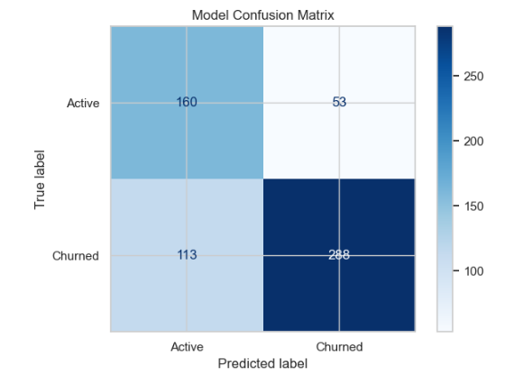

# 🎬 MavenFlix Subscription Churn & Retention Analytics

An end-to-end data analytics and machine learning project analyzing 3,000+ subscription records to identify key drivers of customer attrition and build a classification model to predict renewals.

## 📌 Executive Summary
* **Churn Baseline:** Evaluated customer retention rates across various subscription intervals and pricing tiers.
* **Model Benchmark:** Trained a **Random Forest Classifier** with balanced class weights, attaining an **ROC-AUC of 0.79** and **73% accuracy**.
* **Key Findings:** Subscription interval and payment completion status serve as the strongest leading indicators of whether a subscriber cancels.

---

## 🛠️ Tech Stack & Libraries
* **Language:** Python 3.x
* **Data Manipulation:** Pandas, NumPy
* **Visualization:** Matplotlib, Seaborn
* **Machine Learning:** Scikit-Learn (Random Forest Classifier, Train-Test Split, Classification Metrics)
* **Environment:** Anaconda / Jupyter Notebook

---

## 📊 Key Results & Visuals

### 1. Key Drivers of Churn (Feature Importance)

### 2. Model Confusion Matrix

---

## 💡 Business Recommendations
1. **Targeted Renewal Incentives:** Proactively reach out to users with high-churn subscription tiers before their renewal cutoff date.
2. **Onboarding Support:** Accounts that show payment friction or irregular signup timing churn at significantly higher rates; automated onboarding alerts can reduce early drop-offs.
